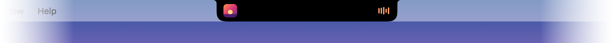

# Island

**A Dynamic Island for your MacBook's notch. Four things, done right. It never covers your menu bar.**

<p align="center"></p>

<p align="center"><a href="https://github.com/firegranger/island/releases/latest/download/Island.zip"><b>Download</b></a> · free and open source · macOS 15+ · MacBook with a notch · <a href="README.fr.md">Version française</a></p>

---

## Why another notch app?

Notch apps are great until you actually use them. They grow sideways over the menu bar, hide your menus and status icons, and pile on features nobody asked for: file shelves, AirDrop, clipboard history, calendars, widgets… And most of them cost money.

Island takes the opposite approach.

### It never covers your menu bar

Island continuously measures the menu bar on each side of the notch: the active app's menus (including the ones macOS pushes to the right of the notch when an app has too many) and every status icon. Then it picks the first layout that fits:

**Room on both sides:** artwork on the left, spectrum on the right, just like on iPhone.


**Crowded on the left:** everything moves to the right.


**Crowded on both sides** (here, the app's *Window* and *Help* menus were pushed past the notch): Island drops below the notch, keeping the notch's width.


Switch apps and it rearranges itself within a second or two.

### Four features, nothing else

- **Now playing** (Music, Spotify, browsers…): artwork and a live audio spectrum tinted with the artwork's colors. When the track changes, the title and artist drop down for a few seconds. After a pause, Island stays visible for a few more seconds before tucking away.
- **Volume** and **brightness**: replaces the macOS indicator.
- **Notifications** *(experimental)*: they drop down from the notch.

No settings window, no Dock icon, no account.

<table><tr>
<td></td>
<td></td>
</tr></table>

### Seamless

- **Invisible at rest.** Island hides entirely behind the notch and takes its exact shape, with flared top corners and rounded bottom corners. When it shrinks back, it looks like the notch itself returning to its size.
- **Smooth motion.** Island morphs with springy, iPhone-like animations. Content fades in from a blur once the shape opens, and fades away before it closes.
- **The cursor disappears inside the notch,** as if it had slipped behind it. Hovering makes the island swell slightly, with a subtle haptic tick.
- **Only where there's a notch.** When mirroring to a projector, using a 16:9 resolution or working with the lid closed, Island steps aside and macOS takes the volume and brightness keys back. With an external display, Island stays on the MacBook screen.
- **Private.** Nothing leaves your Mac: no network, no analytics. The audio spectrum is computed on the fly and nothing is recorded.

## Gestures

| Gesture | Action |
|---|---|
| Hover the notch | The island swells slightly, with a haptic tick |
| Click | Play / pause |
| Two-finger swipe on the notch | Fingers to the left: next track · to the right: previous |
| Click a notification | Opens the app |
| ⌥⇧ + volume/brightness keys | Finer steps |
| Right-click | Open at login, permissions, Quit |

## Install

1. [Download Island.zip](https://github.com/firegranger/island/releases/latest/download/Island.zip), unzip it and move **Island** to your Applications folder.
2. Open it. Island isn't notarized (that requires a paid Apple developer account), so macOS will refuse to open it the first time. Go to **System Settings › Privacy & Security**, scroll down and click **Open Anyway**.
   Or, in Terminal:
   ```bash
   xattr -dr com.apple.quarantine /Applications/Island.app
   ```
3. Grant the permissions you want (see below), then right-click the notch and choose **Open at login**.

### Permissions

All of these are in **System Settings › Privacy & Security**.

| Permission | Used for | Without it |
|---|---|---|
| **Accessibility** | Volume/brightness keys, measuring free space in the menu bar | macOS keeps its own volume/brightness indicator; Island always stays below the notch |
| **System Audio Recording** | The live spectrum. Sound is analyzed on the fly and never recorded. | The spectrum is just animated |
| **Full Disk Access** | Notifications: macOS has no API to read other apps' notifications, so Island reads the Notification Center database, read-only | No notifications |

To avoid seeing each notification twice, go to **System Settings › Notifications**, pick the app and set its alert style to **None**.

## Build from source

The Command Line Tools are enough; Xcode isn't needed.

```bash
git clone https://github.com/firegranger/island.git && cd island
./build.sh install
```

The script builds, signs, copies the app to `/Applications` and launches it. If you have an *Apple Development* certificate, it's used, so permissions survive rebuilds. Otherwise the app is signed ad hoc. `./build.sh dist` produces the zip published in the releases.

## Under the hood

Native Swift (SwiftUI + AppKit), no dependencies. Code comments are in French.

- `IslandController`: the window over the notch, hover, swipe, cursor. Clicks pass through everywhere outside the island.
- `IslandModel`: what is shown, and where.
- `IslandView`: the shape and every animation (`Motion`).
- `MenuBarScanner`: free space in the menu bar, through the Accessibility API.
- `AudioSpectrum`: a Core Audio process tap and an FFT (Accelerate).
- `SystemControls`: the keys (event tap), CoreAudio, DisplayServices.
- `NowPlaying` + `Bridge/`: since macOS 15.4, MediaRemote (now playing) is only available to Apple binaries. A small dylib is loaded into `/usr/bin/perl`, which relays the info as JSON.
- `NotificationWatcher`: reads the Notification Center database.

## Limitations

- Several features rely on private macOS APIs or files (now playing, brightness, notifications). A macOS update can break them.
- Notifications are still experimental.
- The right-click menu is in French for now.
- Tested on a 14" MacBook Pro running macOS 27.

## License

[MIT](LICENSE)
